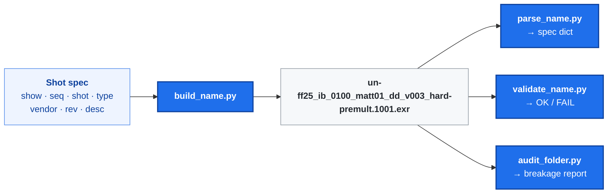

<div align="center">

# agent-skills

**Agent skills for media and studio creation**

[](https://github.com/Holli-Tech/agent-skills/actions/workflows/ci.yml)
[](LICENSE)

Skills that give an AI agent the domain knowledge of a studio —
file naming conventions, pipeline rules, delivery formats — instead of
guessing them from a blog post.

</div>

---

## What is a skill here?

A **skill** is a folder with a `SKILL.md` at its root: a short description that
tells the agent *when* to reach for it, plus the domain knowledge to do the job
right. Some skills also ship executable scripts, so the rules are enforced
rather than merely described.

```text
skills/<category>/<skill-name>/
├── SKILL.md          # the trigger + the knowledge
├── references/       # long-form docs consulted on demand
└── scripts/          # executable tooling + smoke tests
```

Drop a skill into your agent's skills directory and it is available. In
[Hermes](https://github.com/NousResearch/hermes-agent):

```bash
git clone https://github.com/Holli-Tech/agent-skills.git
cp -r agent-skills/skills/creative/vfx-file-naming \
      ~/.hermes/profiles/<profile>/skills/creative/
```

---

## Available skills

| Skill | What it gives you |
|---|---|
| **[`vfx-file-naming`](skills/creative/vfx-file-naming/)** | A spec-compliant naming grammar for VFX image sequences — plates, mattes, comps, render passes — with a builder, a parser, a validator and a folder auditor. |

---

## `vfx-file-naming`

Most studios have a naming convention. Almost none of them are written down,
and the ones that are rarely travel between shows, vendors or tools. This skill
distils the parts that **are** standardised — primarily the
[ETC@USC / MovieLabs *VFX Image Sequence Naming*][etc] specification
(TR-VFX-IS v1.0, June 2020), which is itself aligned with the
[VES Transfer Specification][ves] — into a grammar you can apply by hand or
have a script enforce.

### The grammar

A VFX image-sequence filename is one line, no spaces, tokens separated by
underscores:

```text
<show>_<seq>_<shot>_<type>_<vendor>_v<rev>{_<description>}.<frame>.<ext>
```

| Token | Meaning | Example |
|---|---|---|
| `<show>` | Show / episode ID, unique per title. Optional 2-char studio prefix, joined by a dash | `un-ff25` |
| `<seq>` | VFX sequence, or `show` / `act1` / `reel2` / `part1` | `ib` |
| `<shot>` | 4-digit shot number, starts at `0100`. `0000` = no shot applies | `0100` |
| `<type>` | Image type from the controlled vocabulary | `matt01` |
| `<vendor>` | 2–3 char vendor code, assigned by production | `dd` |
| `v<rev>` | Revision, 3+ digits, zero-padded | `v003` |
| `<frame>` | 4+ digits (single-frame files only) | `1001` |

Put together — this is the specification's own worked example, for a hard
premultiplied matte of shot `0100`:

```text
un-ff25_ib_0100_matt01_dd_v003_hard-premult.1001.exr
```

*Show `un-ff25` (Universal's Fast and Furious 25), sequence `ib`, shot `0100`,
matte #01, made by `dd` (Digital Domain), revision 3, a hard premultiplied
matte, frame 1001, OpenEXR.*

### The vocabulary is fixed, and it is not two letters

The spec's controlled vocabulary covers plates (`mp`, `bg`, `fg`, `el`, `cp`,
`rg`) and everything else (`matt`, `comp`, `FINAL`, `anim`, `cnpt`, `layo`,
`ldev`, `prev`, `pstv`, `prox`, `repo`, `spfx`, `test`, `time`, `vcam`,
`other-<custom>`). A 2-digit instance number distinguishes several of the same
type on one shot — `matt01`, `matt02` — and means *a different plate*, not a new
revision.

### Mattes get their own vocabulary

Mattes are where naming usually goes wrong: there are a dozen kinds, they look
alike, and a hard matte and a soft matte are not interchangeable downstream.
Each type gets a fixed token in the description slot:

| Token | Matte type |
|---|---|
| `hard` | Binary alpha, silhouette only |
| `soft` | Grayscale alpha, anti-aliased |
| `key` / `core` / `edge` | Colour-key output and its inner / transition zones |
| `roto-<subject>` | Frame-by-frame rotoscoping |
| `garbage` | Cut-out of unwanted elements |
| `crypto-object` / `-material` / `-asset` | Cryptomatte ID mattes |
| `pw-<n>` / `qualifier-<n>` | DaVinci Resolve power window / qualifier |

Premultiplication state is explicit too — `-premult`, `-unpremult` or
`-premulrsa` — because a beauty and its matte that disagree on the flag will
get unpremultiplied twice.

### The tooling

The rules are executable, not just prose:



```bash
cd skills/creative/vfx-file-naming/scripts

# Build a spec-compliant name
python3 build_name.py --show un-ff25 --seq ib --shot 0100 --type matt \
    --instance 01 --vendor dd --rev 3 --description hard-premult \
    --frame 1001 --ext exr

# Parse one back into a dict
python3 parse_name.py un-ff25_ib_0100_matt01_dd_v003_hard-premult.1001.exr

# Validate one (exit 0 = compliant, 1 = not)
python3 validate_name.py un-ff25_ib_0100_matt01_dd_v003_hard-premult.1001.exr

# Audit a whole folder (exit code = number of broken files)
python3 audit_folder.py /path/to/shots --json
```

`app_presets.py` additionally ships ready-to-paste output templates for Nuke,
Photoshop, Blender, DaVinci Resolve, After Effects and Houdini.

### Read the spec, don't guess it

The specification is the primary source, and it is more subtle than it looks:
its worked examples use a different description separator than its own syntax
block, and place the description in a different slot. The skill documents each
discrepancy explicitly, keeps the normative form as the output, and makes the
parser accept every form the specification itself uses.

### Why it ships with tests

Every filename printed in the documentation is a **contract with the
validator**. CI extracts all of them and checks each one, so the docs cannot
drift away from the implementation. The skill's own suite is 58 cases, and its
fixtures are the specification's own worked examples — so the suite doubles as
a conformance check against the primary source.

```bash
cd skills/creative/vfx-file-naming/scripts
bash test_smoke.sh      # → 58 passed, 0 failed
bash check_examples.sh  # → 39/39 examples validate
```

---

## Contributing

New skills are welcome. The shape is simple:

1. A folder under `skills/<category>/<name>/` with a `SKILL.md` whose
   frontmatter carries `name`, `description` (starting with *Use when…*),
   `version`, `author` and `license`.
2. Long-form material goes in `references/`, code in `scripts/`.
3. If you ship scripts, ship `scripts/test_smoke.sh` next to them — bash, exit
   codes, no framework. The CI workflow picks up every skill that has one.
4. Add the skill to the table above.

CI runs the smoke tests, re-validates every filename example found in the
documentation, and checks each `SKILL.md`'s frontmatter.

---

## Sources

- [VFX Image Sequence Naming][etc] — TR-VFX-IS v1.0, June 2020, ETC@USC / MovieLabs. The primary reference; mirrored in `skills/creative/vfx-file-naming/references/`.
- [VES Transfer Specification][ves] — the controlled vocabulary for image types.
- [MovieLabs Common Metadata][md] — the broader metadata model this naming sits inside.
- [Digital Cinema Naming Conventions][dcnc] — the delivery convention it descends from.

[etc]: https://movielabs.com/prodtech/sdw/vfx/ETC-ImageSequenceNaming-v1.0-063020-FINAL.pdf
[ves]: https://vestransferspec.org/
[md]: https://movielabs.com/md/md/
[dcnc]: https://isdcf.com/dcnc/

---

## License

[MIT](LICENSE) © 2026 HOLLI
